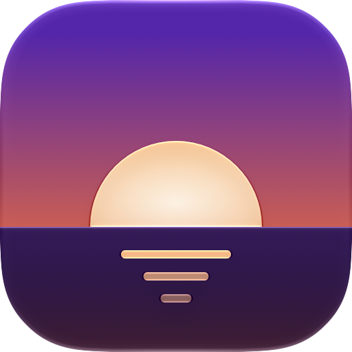

<div align="center">
  <picture>
    <source media="(prefers-color-scheme: dark)" srcset="docs/icon-dark.png">
    
  </picture>
  <h1>Crepuscule</h1>
  <p>A Film RAW camera that lives on your iPhone</p>
</div>

Every press of the shutter is a burst of RAW frames, merged into one cleaner RAW, then developed like film : LogC, a print-film curve, halation and grain. the RAW always stays untouched next to it

## What's inside
- **Burst Merge** : each shot is a quick burst of RAW frames (up to 8, more when zoomed in) aligned and merged into one. Less noise without smearing detail, plus a couple of darker frames to pull back highlights
- **Night bursts** : in low light, up to 16 short frames instead of one long blurry one, sized from the gyro so the shutter only gets as fast as your hands need. A little moon shows up when it kicks in
- **Looks** : Factory and Mono out of the box, with live preview in the viewfinder. The editor has Tone, Color and Texture tools, and anything you like can be saved as your own look
- **14 to 270 mm** : slide the lens pill or pinch. Past 2×, shots get rebuilt with multi-frame super-resolution, using the tiny movements of your hands between frames. Real extra detail, not just a crop. On Pro iPhones, zoom crops the telephoto once you're past its focal length
- **Drive modes** : 3 and 5-shot bursts and brackets, a 3s/10s self timer, and for those the camera waits until the phone stops moving before it fires
- **Manual controls** : shutter, ISO, aperture on lenses that have one, and focus. Leave any of them on Auto and the camera handles the rest
- **Everywhere iOS lets a camera be** : Lock Screen camera, Control Center controls, Camera Control (light double-press for zoom, looks...)
- Export to HEIC or JPEG at the size you want, optionally with the RAW attached, and a QR/barcode scanner in the viewfinder because why not

## From shutter to photo
1. **Planning the burst.** Before shooting, Crepuscule reads the live histogram and the exposure, and decides how many frames to take, at which ISO and shutter speed, and whether some of them should be darker to protect the highlights. Zoomed shots get more frames, night shots get shorter ones
2. **Merging.** The frames get aligned tile by tile and merged with a robust merge, so anything that moved between frames doesn't ghost. When you're zoomed in past 2×, a super-resolution pass replaces the plain merge and rebuilds the crop at up to twice the resolution. Either way, the result is written back as a regular DNG
3. **Developing.** The DNG gets demosaiced, converted to LogC, run through a 65³ print-film LUT, then halation and grain are added on top. All of it runs on Metal, and the same pipeline powers the viewfinder preview, the library, the editor and exports
4. **Viewing.** The library works on small compressed proxies so everything opens instantly. Zoom into a photo and Crepuscule renders the actual full-resolution export, so what you see zoomed in is exactly what you'd export

## About the RAW
A few things worth knowing, so they don't surprise you :
- On iPhones with a 48 MP main camera, the RAW frames Apple gives third-party apps are **12 MP**. The sensor is quad-Bayer (pixels come in 2×2 groups of the same colour), and the clean, binned 12 MP readout is the only Bayer RAW that's exposed. The burst merge and super-resolution are how Crepuscule gets real detail back on top of that
- On Pro iPhones, Burst Merge shoots Bayer RAW (so it can merge). Turn Burst Merge off and you get single ProRAW frames instead
- The telephoto handoff obviously needs a phone with a telephoto

## Building
You'll need :
- Xcode 27 or later
- an iPhone on iOS 27 or later (the Simulator runs a demo camera, fine for UI work but nothing else)
- an Apple ID to sign the app (a free one works)

Then :
```
git clone https://github.com/c22dev/Crepuscule
cd Crepuscule
open Crepuscule.xcodeproj
```

## Limitations
- iPhone only
- Not on the App Store (yet ?)

## Credits
- Introduction photos by Jonathan Bieler and Colin Mckinney, under CC BY-SA 4.0
